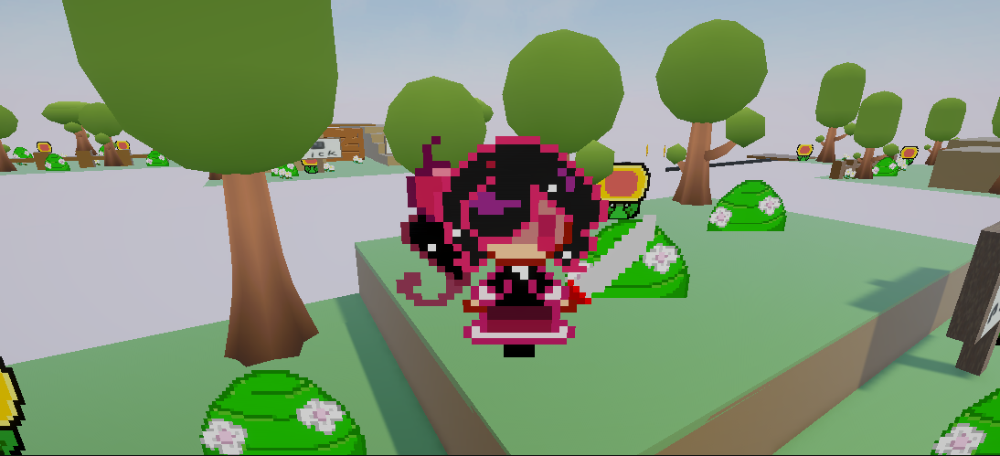
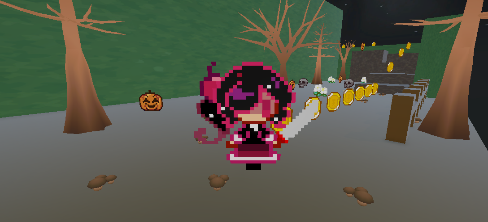

# Little Adventure — PaperTeam

**TFI · Programación de Videojuegos 1**
**Estudio:** PaperTeam
**Motor:** Unity 6.5 (6000.5.8f1)

## Integrante

**Desarrollador:** Santiago Chosco
**LU:** TUV000783

## Descripción

Vertical Slice de acción y aventura 3D. El jugador recorre 2 niveles con
desniveles y rampas para recuperar un cubo y entregarlo en la meta, esquivando
enemigos con IA. Flujo completo: Menú, Opciones, Tutorial, Nivel 1, Nivel 2,
Victoria y Game Over.

**Opcionales implementadas:**
- **Tienda entre niveles:** terminal interactiva donde el jugador gasta las monedas acumuladas.
- **Selector de dificultad:** Fácil / Normal / Difícil desde el Menú Principal.

## Capturas

## Controles

| Acción | Tecla |
|---|---|
| Mover al personaje | Flechas |
| Mover la cámara | A / S / W / D |
| Recoger y abrir cosas | E |
| Poder especial de velocidad | Z |
| Atacar | C |
| Saltar | Espacio |
| Pausar | P |

## Arquitectura

Eventos de C# + ScriptableObjects para desacoplar gameplay, UI y audio.

| Script | Función |
|---|---|
| `GameManager` | Estados, pausa, victoria, derrota y puntaje |
| `PlayerController` | Movimiento, salto, ataque e interacción |
| `PlayerHealth` | Vida y daño del jugador |
| `EnemyHealth` | Vida de los enemigos |
| `EnemyAI` | Patrulla, persecución y ataque |
| `HealingStation` | Curación con cooldown |
| `ToxicZone` / `MudZone` | Daño por tiempo / desaceleración |
| `PowerUpInvisibility` | Invisibilidad y vuelta a patrulla |
| `AudioManager` / `OptionsMenu` | Audio y sliders |

## Cómo ejecutar

1. Clonar el repositorio.
2. Unity Hub → **Add** → elegir la carpeta del proyecto.
3. Abrir la escena `MainMenu` y darle **Play**.